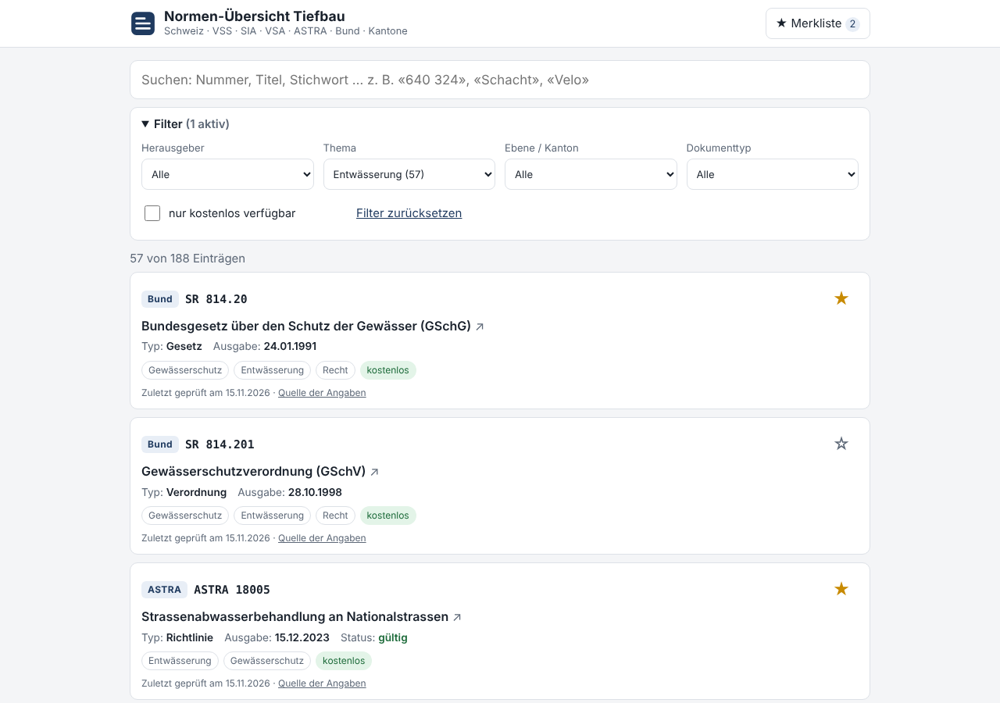
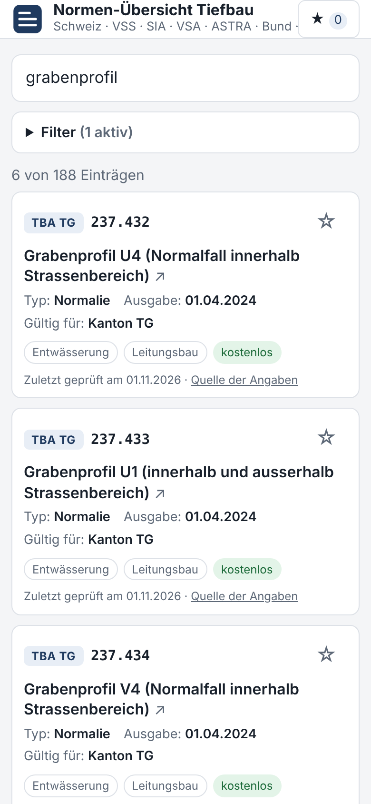

# Normen-Übersicht Tiefbau Schweiz

<!-- TODO vor Veröffentlichung: swiss-open-tools/normen-uebersicht und PARTNER_CODE ersetzen (Hostinger Open-Source-Partnerprogramm). -->
[](https://www.hostinger.com/deploy?template=swiss-open-tools/normen-uebersicht&ref=PARTNER_CODE)

**DE** | [EN](#english)

Ein durchsuchbares Verzeichnis der Normen, Richtlinien und Vorgaben, die im **Tief- und Strassenbau
in der Schweiz** gebraucht werden: VSS, SIA, VSA, ASTRA, Bundeserlasse und kantonale Vorgaben
(zuerst Kanton **Thurgau**). Pro Eintrag gibt es Nummer, Titel, Ausgabe, Status (falls belegt),
Thema, «kostenlos ja/nein», den Link zur **offiziellen Quelle** und das Datum, an dem der Eintrag
**zuletzt geprüft** wurde.

> **Nur Verzeichnis, keine Normtexte.** Erfasst sind ausschliesslich bibliografische Angaben.
> Massgebend ist immer der Herausgeber. Alle Angaben ohne Gewähr. Status und Ausgabe vor Gebrauch prüfen.

| Desktop | Handy |
|---|---|
|  |  |

## Funktionen

- **Volltextsuche** über Nummer, Titel, Thema und Stichworte. Umlaut-tolerant, findet `640 324`, `640324` und `40 324`.
- **Filter** nach Herausgeber, Thema, Ebene/Kanton, Dokumenttyp und «nur kostenlos».
- **Merkliste** (★): bleibt im Browser gespeichert und lässt sich als Text kopieren (Link-Liste für Mail oder Bericht).
- **Teilbare Links**: Suche und Filter stehen in der Adresse, z. B. `#ebene=kanton%3ATG&thema=Entwässerung`.
- **Offline-fähig** (Service Worker) und **mobil** gut bedienbar. Dunkelmodus folgt dem System.
- Kein Tracking, keine Cookies, keine externen Schriften oder CDNs.

## Datenstand

`data/normen.json` – **188 Einträge**, alle einzeln aus einer geprüften Quelle (Stand 15.11.2026):

| Herausgeber | Einträge | Belegt durch |
|---|---:|---|
| VSS | 61 | VSS 41 001:2024-10 Gesamt-Normenverzeichnis (mobilityplatform.ch) |
| SIA | 19 | SIA-Publikationsliste (cms.sia.ch) |
| VSA | 15 | vsa.ch Mediathek / Fachbereich Regenwetter |
| ASTRA | 11 | astra.admin.ch Richtlinien / Trassee |
| Bund (Erlasse) | 5 | LexFind / admin.ch |
| Kanton Thurgau | 77 | tiefbauamt.tg.ch (Normalien, Weisungen), umwelt.tg.ch, LexFind |

Schwerpunkte: Oberbau, Entwässerung, Leitungsbau, Baustellen, Velo-/Fussverkehr, Thurgauer Normalien.

## Starten

### Als statische Website (empfohlen)

```bash
npm run build        # erzeugt dist/ (Node ≥ 18, keine Abhängigkeiten)
```

`dist/` ist eine reine statische Website mit relativen Pfaden. Du kannst sie auf jeden Webspace hochladen
(Hostinger Webhosting, GitHub Pages, Netlify …), auch in einen Unterordner. `dist/index.html`
funktioniert sogar per Doppelklick (file://), weil die Daten als `js/normen-data.js` eingebettet sind.
Der Service Worker (Offline-Modus) läuft nur über http/https.

### Lokal entwickeln

```bash
npm start            # http://localhost:3000 – liefert public/ + data/ direkt aus
```

### Docker / Hostinger VPS

```bash
docker compose -f docker-compose.yml -f docker-compose.local.yml up --build   # http://localhost:8080
```

Das Image baut `dist/` und liefert es mit nginx (unprivilegiert, Port 8080, `/healthz`) aus.
`docker-compose.yml` baut direkt aus dem GitHub-Repo, damit «Deploy on Hostinger» funktioniert.
Dafür vorher `OWNER` ersetzen.

## Tests

```bash
npm test             # Unit-Tests Suche/Filter, Datenqualität, JSON-Schema, statischer Build, Server-Smoke-Test
npm run validate     # nur JSON-Schema + Zusatzregeln (pip install jsonschema)
npm run linkcheck    # prüft alle Links (braucht Internet; 404/410 → Fehler)
npm run build && npm run screenshot   # Playwright: Browser-Smoke-Test (inkl. offline + file://) und Screenshots
```

**Linkcheck – Einschränkung:** In der Build-Umgebung dieses Projekts gab es keinen direkten Internetzugang.
`npm run linkcheck` meldete darum alle 67 eindeutigen Links als «unklar» (DNS) und keinen als kaputt.
Die Links stammen aber alle aus Seiten, die während der Recherche einzeln abgerufen wurden
(Verzeichnis-PDFs, Downloadseiten, LexFind). Vor dem Veröffentlichen einmal mit Internet ausführen.
Nicht direkt abgerufen wurde nur `https://shop.sia.ch/` (Shop-Startseite).

## Mitmachen

Einträge ergänzen oder korrigieren: siehe [CONTRIBUTING.md](CONTRIBUTING.md) (Schema, Regeln, Beispiel).
Idee, Zielgruppe und Pflegeaufwand: [KONZEPT.md](KONZEPT.md).

## Lizenz

- **Code:** [MIT](LICENSE).
- **Daten (`data/normen.json`):** Die Zusammenstellung stellen wir unter **CC0 1.0** (gemeinfrei),
  damit Büros und Schulen sie frei weiterverwenden können. Die Daten enthalten nur Fakten
  (Nummern, Daten) und amtliche bzw. vom Herausgeber selbst veröffentlichte Titel, keine geschützten
  Inhalte. Die **Normen selbst** sind urheberrechtlich geschützt und nur beim jeweiligen
  Herausgeber erhältlich. Namen und Kürzel (VSS, SIA, VSA, ASTRA) gehören den jeweiligen Organisationen,
  das Projekt ist mit keiner davon verbunden. Begründung: [docs/URHEBERRECHT.md](docs/URHEBERRECHT.md)
  (keine Rechtsberatung). Herausgeber können die Korrektur oder Entfernung eines Eintrags verlangen.

---

<a id="english"></a>
## English

**Swiss civil & road engineering standards index.** This is a searchable, offline-capable directory of the
standards and guidelines used in Swiss road and civil engineering: VSS, SIA, VSA, ASTRA, federal
acts and cantonal rules (starting with the canton of **Thurgau**). It contains **metadata only**
(issuer, number, title, edition, status where documented, topic, free/paid). Each entry links to the official
source and shows when it was last checked. It contains no standard texts.

- **Use it:** `npm run build` creates `dist/`, a plain static site with relative paths. It also works via `file://`.
  Run `npm start` for local development, or `docker compose -f docker-compose.yml -f docker-compose.local.yml up --build`.
- **Data:** `data/normen.json` has 188 entries, each verified against a public source and validated by
  `data/normen.schema.json`. See [CONTRIBUTING.md](CONTRIBUTING.md) (German) for the schema.
- **Licence:** the code is MIT. The data compilation is CC0 1.0. The standards themselves are copyrighted by their
  publishers and are not included. The UI and data are German-only for now.
